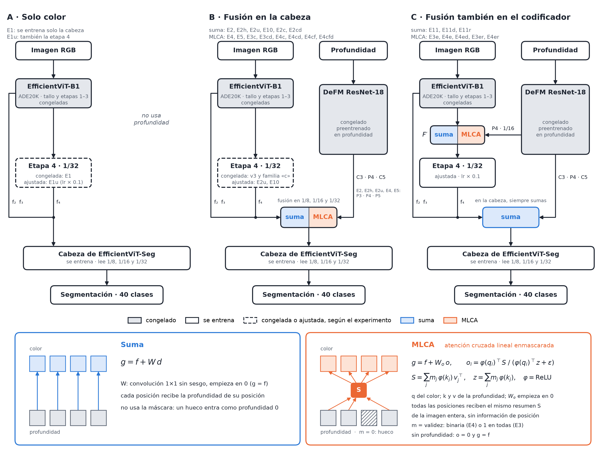
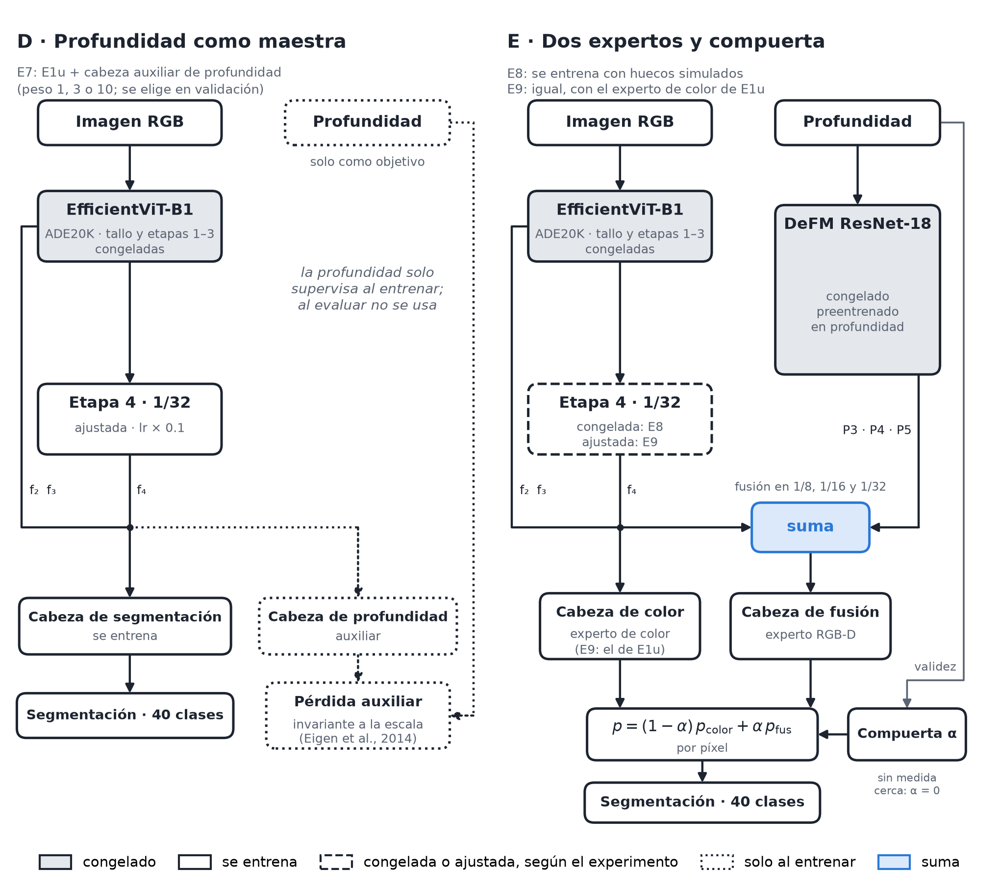

# Arquitecturas probadas

Todas las variantes entrenadas en NYUv2 (40 clases): sus esquemas y un catálogo de qué cambia en cada
experimento. Las figuras salen de `tools/figura_arquitecturas.py`, en español y en inglés, en PNG y PDF
(`proposal/figs/arquitecturas_*`). La tabla del final sale de `tools/catalogo_experimentos.py`. Lo que dibujan es
el código de `src/rgbd.py` (`RGBD`) y `src/mlca.py` (`MLCA`).

## Las piezas comunes

- **Color:** EfficientViT-B1 de segmentación, preentrenado en ADE20K. El tallo y las etapas 1–3 están siempre
  congelados. La etapa 4 (1/32) se ajusta en algunos experimentos, con una lr 10 veces menor que la de la cabeza.
- **Profundidad:** DeFM ResNet-18, congelado. Hasta E9 se usaron las salidas de su BiFPN (P3, P4, P5). D-05
  encontró que P3 y P5 no dependen de la entrada; desde E10 se usan C3 y C5 del ResNet, con P4 (C3·P4·C5).
- **Cabeza:** la de EfficientViT-Seg (de ADE20K, con el clasificador cambiado a 40 clases), siempre entrenada.
  Lee los rasgos de 1/8, 1/16 y 1/32 y predice a 1/8.
- **Huecos:** un píxel sin medida vale 0, y la validez es «profundidad > 0». La validez solo la usan la MLCA
  (como máscara m) y la compuerta de E8 y E9.

## Esquemas principales

- **A · Solo color.** La referencia. E1 entrena solo la cabeza (44.99); E1u, también la etapa 4 (47.31).
- **B · Fusión en la cabeza.** La profundidad entra después del codificador de color, en los tres rasgos que lee
  la cabeza; el codificador de color nunca la ve. El operador es la suma o la MLCA.
- **C · Fusión también en el codificador.** Como B, y además la profundidad de 1/16 (P4) entra a la etapa 4 del
  color (F′), que se ajusta. Las tres fusiones de la cabeza son siempre sumas: entre E11 y E4e solo cambia F′,
  que es una suma en E11 y una MLCA en E4e.

Los dos operadores, abajo en la figura:

- **Suma:** g = f + W·d, con W una convolución 1×1 iniciada en cero. Cada posición recibe la profundidad de su
  misma posición. No usa la máscara: un hueco entra como profundidad 0.
- **MLCA** (*masked linear cross-attention*): g = f + W_o·o, con o una atención cruzada lineal en la que el color
  pregunta (q) y la profundidad responde (k, v). Toda la profundidad válida se resume en una matriz S, la misma
  para todas las posiciones, y cada posición la pondera con su consulta. No hay codificación de posición. La
  máscara m saca los huecos de S; sin profundidad, o = 0 y g = f.

Esa diferencia explica la mayor parte de los resultados. Con la profundidad completa, la suma le da a cada píxel
su profundidad y gana: E11d, con 51.26, supera a E4ed, con 49.24. La MLCA da un resumen de toda la imagen, que
pierde detalle espacial pero se estropea menos cuando la profundidad es mala (cuaderno 12, sección 6). En D-08 se
entrenaron E11d, E3ed y E4ed con la profundidad cruda del sensor en lugar de la rellenada (E11r, E3er y E4er): con
los huecos del sensor, la suma llega a 51.39, y la MLCA con máscara queda entre 2 y 3.7 puntos bajo ella.

## Esquemas complementarios

- **D · Profundidad como maestra (E7).** La red es E1u, y la profundidad solo supervisa una cabeza auxiliar al
  entrenar. Al evaluar no se usa, así que da lo mismo en todas las condiciones (47.28).
- **E · Dos expertos y compuerta (E8, E9).** Un experto de color y uno RGB-D (con sumas) se mezclan por píxel
  con una compuerta α que solo mira la validez. Donde no hay ninguna medida cerca, α = 0 y la salida es
  exactamente la del experto de color. En E9 ese experto es E1u: sin profundidad da 47.31, lo mismo que E1u.

## Qué pregunta contesta cada comparación

Cada experimento existe para compararlo con otro que cambia en una sola cosa. Diferencias de medias en el test (3
semillas); la significación de cada contraste está en el cuaderno 12 (sección 5) y en `DECISIONES.md`.

| Pregunta | Se compara | Respuesta |
|---|---|---|
| ¿Ayuda la profundidad? | E2c − E1 (cabeza); E11 − E1u (codificador) | Sí, con profundidad completa: +2.54 en la cabeza y +3.75 en el codificador |
| ¿Dónde rinde más? | E11 − E10 (la misma suma en la cabeza, más la del codificador) | En el codificador: +1.82 |
| ¿Fusiona mejor la MLCA que la suma? | E2c − E4c, E11 − E4e, E11d − E4ed, E11r − E4er | No: con profundidad, la suma gana en los cuatro pares (+1.67 a +3.67) |
| ¿Sirve la máscara? | E4c − E3c, E4e − E3e (derivados) y E4er − E3er (D-08, entrenado) | Solo sin profundidad y sin dropout (+9.39 en el codificador); con los huecos del sensor, de −0.63 a +0.10; activa al entrenar, perjudica (−1.07 a −3.82) |
| ¿Sin dropout, la MLCA aguanta mejor una profundidad mala? | E4e − E11 | Sí: −1.67 con profundidad completa, pero +5.98 con el 50 % de huecos y +23.0 sin profundidad |
| ¿Da robustez el *modality dropout*? | E2cd − E2c, E4cd − E4c, E11d − E11, E4ed − E4e | Sí y sin costo: de −0.15 a +0.52 con profundidad completa y de +8.5 a +31.7 sin ella |
| ¿Y entrenar con los huecos del sensor? | E11r − E11d, E4er − E4ed (D-08) | A la suma le sirve con esos huecos (+0.98; 51.39) y le cuesta ~0.6 con profundidad completa; a la MLCA, no |
| ¿Basta la profundidad como maestra al entrenar? | E7 − E1u | No: −0.03 |
| ¿Y dos expertos con compuerta? | E9 − E1u | Sin profundidad da exactamente solo color; con ella, +0.45 |
| ¿Cuál es el mejor modelo único? | todos frente a E1u (47.31) | Con profundidad completa, E11d (51.26); con la del sensor, E11r (51.39) |

## Catálogo

<!-- catálogo: inicio -->
| Exp. | Dec. | Esq. | Qué es | Cabeza | Codificador | Rasgos de prof. | Etapa 4 | Profundidad al entrenar | lr | Completa | Cruda | 50 %* | Sin |
|---|---|---|---|---|---|---|---|---|---|---|---|---|---|
| E1 | v3 | A | solo color | — | — | — | congelada | — | 0.001 | 44.99 | 44.99 | 44.99 | 44.99 |
| E2 | v3 | B | f + W·f_prof (1×1, W=0 al inicio) | suma | — | P3·P4·P5 | congelada | rellenada | 0.0003 | 47.31 | 46.97 | 43.90 | 42.25 |
| E4 | v3 | B | MLCA, máscara fraccional | MLCA fraccional | — | P3·P4·P5 | congelada | rellenada | 0.0003 | 45.24 | 45.04 | 41.89 | 0.78 |
| E5 | v3 | B | E4 + dropout 0.3 | MLCA fraccional | — | P3·P4·P5 | congelada | rellenada + dropout 0.3 | 0.0003 | 45.48 | 45.45 | 44.25 | 45.74 |
| E1u | D-03 | A | E1 + última etapa ajustada | — | — | — | ajustada | — | 0.001 | 47.31 | 47.31 | 47.31 | 47.31 |
| E7 | D-03 | D | E1u + profundidad como maestra | — | — | — | ajustada | rellenada, como objetivo | 0.001 | 47.28 | 47.28 | 47.28 | 47.28 |
| E8 | D-03 | E | dos expertos + compuerta | suma + experto de color | — | P3·P4·P5 | congelada | rellenada + huecos simulados | 0.003 | 48.17 | 47.08 | 45.11 | 44.00 |
| E2h | D-03 | B | E2 + huecos al entrenar | suma | — | P3·P4·P5 | congelada | rellenada + huecos simulados | 0.001 | 46.98 | 46.63 | 43.95 | 44.59 |
| E2u | D-04 | B | E2 + última etapa | suma | — | P3·P4·P5 | ajustada | rellenada | 0.003 | 48.59 | 47.71 | 43.90 | 36.84 |
| E9 | D-04 | E | E8 con el experto de color = E1u | suma + experto de color | — | P3·P4·P5 | ajustada | rellenada + huecos simulados | 0.0003 | 47.76 | 47.72 | 47.57 | 47.31 |
| E10 | D-05 | B | E2u con C3/P4/C5 | suma | — | C3·P4·C5 | ajustada | rellenada | 0.001 | 49.24 | 48.10 | 43.13 | 39.15 |
| E11 | D-05 | C | E10 + profundidad en el codificador | suma | suma (W′·P4) | C3·P4·C5 | ajustada | rellenada | 0.003 | 51.06 | 47.71 | 33.39 | 15.75 |
| E2c | D-06 | B | E2 con C3/P4/C5 | suma | — | C3·P4·C5 | congelada | rellenada | 0.003 | 47.53 | 43.32 | 30.38 | 20.33 |
| E3c† | D-06 | B | atención lineal sin máscara (derivado de E4c) | MLCA sin máscara | — | C3·P4·C5 | congelada | rellenada | 0.003 | 44.99 | 41.19 | 22.90 | 13.71 |
| E3cd | D-06 | B | E3c + dropout 0.3 | MLCA sin máscara | — | C3·P4·C5 | congelada | rellenada + dropout 0.3 | 0.001 | 45.45 | 44.91 | 42.15 | 45.31 |
| E4c | D-06 | B | MLCA, máscara binaria (resumen) | MLCA binaria | — | C3·P4·C5 | congelada | rellenada | 0.003 | 44.99 | 40.56 | 23.36 | 14.86 |
| E4cd | D-06 | B | E4c + dropout 0.3 | MLCA binaria | — | C3·P4·C5 | congelada | rellenada + dropout 0.3 | 0.0003 | 45.21 | 44.91 | 42.23 | 46.16 |
| E4cf† | D-06 | B | MLCA, máscara fraccional (derivado de E4c) | MLCA fraccional | — | C3·P4·C5 | congelada | rellenada | 0.003 | 44.99 | 40.44 | 22.97 | 14.86 |
| E4cfd† | D-06 | B | E4cf + dropout 0.3 (derivado de E4cd) | MLCA fraccional | — | C3·P4·C5 | congelada | rellenada + dropout 0.3 | 0.0003 | 45.21 | 44.93 | 42.28 | 46.16 |
| E2cd | D-07 | B | E2c + dropout 0.3 | suma | — | C3·P4·C5 | congelada | rellenada + dropout 0.3 | 0.0003 | 48.05 | 47.66 | 44.58 | 45.47 |
| E11d | D-07 | C | E11 + dropout 0.3 | suma | suma (W′·P4) | C3·P4·C5 | ajustada | rellenada + dropout 0.3 | 0.001 | 51.26 | 50.41 | 45.48 | 47.43 |
| E3e† | D-07 | C | E11 con atención lineal sin máscara en el codificador (derivado de E4e) | suma | MLCA sin máscara | C3·P4·C5 | ajustada | rellenada | 0.001 | 49.39 | 47.68 | 39.16 | 29.36 |
| E4e | D-07 | C | E11 con MLCA (máscara binaria) en el codificador | suma | MLCA binaria | C3·P4·C5 | ajustada | rellenada | 0.001 | 49.39 | 47.78 | 39.37 | 38.75 |
| E3ed | D-07 | C | E3e + dropout 0.3 | suma | MLCA sin máscara | C3·P4·C5 | ajustada | rellenada + dropout 0.3 | — | no se corrió | | | | |
| E4ed | D-07 | C | E4e + dropout 0.3 | suma | MLCA binaria | C3·P4·C5 | ajustada | rellenada + dropout 0.3 | 0.001 | 49.24 | 48.49 | 44.10 | 47.29 |
| E11r | D-08 | C | E11d entrenado con la cruda | suma | suma (W′·P4) | C3·P4·C5 | ajustada | cruda + dropout 0.3 | 0.001 | 50.63 | 51.39 | 45.46 | 47.31 |
| E3er | D-08 | C | E3ed entrenado con la cruda | suma | MLCA sin máscara | C3·P4·C5 | ajustada | cruda + dropout 0.3 | 0.001 | 49.00 | 49.34 | 45.55 | 47.12 |
| E4er | D-08 | C | E4ed entrenado con la cruda | suma | MLCA binaria | C3·P4·C5 | ajustada | cruda + dropout 0.3 | 0.003 | 46.96 | 48.27 | 41.73 | 45.27 |

mIoU en el test oficial de NYUv2 (654 imágenes, 40 clases), media de 3 semillas con la lr elegida en la validación por escenas. Fuente: los `resultado.json` de `runs/rgbd/`, leídos con `estadistica.cargar`; las mismas cifras, con desviación, IC y cada semilla, están en `auditoria/05_tablas_estadisticas.md`. Las de la v3 y D-03 a D-05 son exploratorias (el test se usó en esas decisiones).

\* 50 %: la mitad de los píxeles con profundidad, borrados al azar. Sin: toda la profundidad a cero.

† Derivado sin entrenar: con la profundidad rellenada y sin dropout, la máscara no actúa al entrenar, así que es la misma red que su gemelo, evaluada con otra máscara (D-06).

Esq.: el panel de las figuras (A-E). Dec.: la decisión de `DECISIONES.md` que lo introdujo (v3: el diseño de la propuesta, antes de D-01).
<!-- catálogo: fin -->

## Cómo se corre cada experimento y dónde quedan sus salidas

Cada fila del catálogo es una entrada del registro `EXPERIMENTOS` de `src/entrenar_rgbd.py` (su configuración: fusión,
rasgos de profundidad, etapa 4, dropout, máscara y profundidad de entrenamiento), y el modelo que dibuja su panel
(columna «Esq.») lo arma `src/rgbd.py` (`RGBD`) a partir de esa configuración. Todos usan el mismo protocolo; solo
cambia el nombre del experimento:

| Qué | Comando (desde la raíz del repositorio) |
|---|---|
| Barrido de lr en la validación por escenas, elección y 3 semillas en el test | `python src/entrenar_rgbd.py --completo E11r` |
| Una sola corrida | `python src/entrenar_rgbd.py --exp E11r --lr 1e-3 --semilla 0` |
| Un derivado sin entrenar (los † del catálogo) | `python src/entrenar_rgbd.py --derivar E4e E3e` |
| Combinación sin entrenar de dos modelos | `python src/combinar.py --color E1u --fusion E11d` |
| Una decisión completa, reanudable | `bash tools/cola_d06.sh`, `cola_d07.sh`, `cola_d08.sh` (D-05: `cola_d05.sh`) |
| Tablas, criterio y catálogo | `python src/estadistica.py`; `python tools/criterio_d06.py ...`; `python tools/catalogo_experimentos.py` |

Qué cola corrió cada uno: D-05, `cola_d05.sh` (E2u, E10, E11); D-06, `cola_d06.sh` (E4c, E3c, E4cf, E4cd, E3cd,
E4cfd, E2c); D-07, `cola_d07.sh` (E11d, E2cd, E4e, E3e, E4ed); D-08, `cola_d08.sh` (E4er, E11r, E3er). Los de la v3 y
D-03/D-04 (E1, E2, E4, E5, E1u, E7, E8, E2h, E9) se corrieron con `--completo` uno a uno; `tools/reproducir_historicos.py`
comprueba que el código actual los reproduce.

Cada corrida escribe en `runs/rgbd/<exp>_lr<lr>_s<semilla>/` (las de validación, con el prefijo `val_`):
`resultado.json` (mIoU por condición y por clase, configuración, huella, lr, minutos, entorno y SHA-256 de los pesos
preentrenados), `por_imagen.npz` (intersección y unión por imagen y clase, para el bootstrap), `cabeza.pt` (lo
entrenado) y `estado.pt` (para reanudar). `runs/` no se versiona (pesos); el paquete del equipo trae los
`resultado.json` y `por_imagen.npz`, sin los `.pt`.
