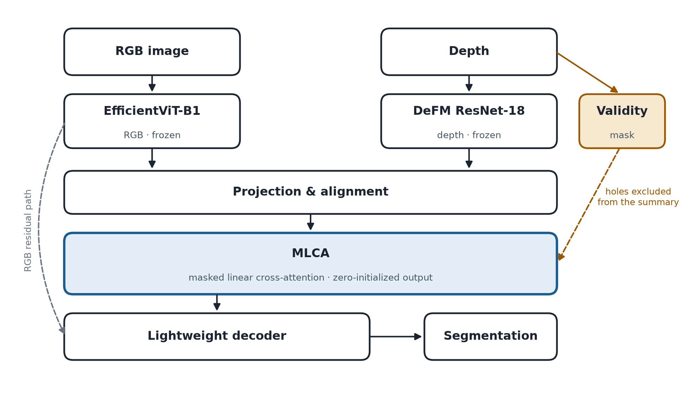
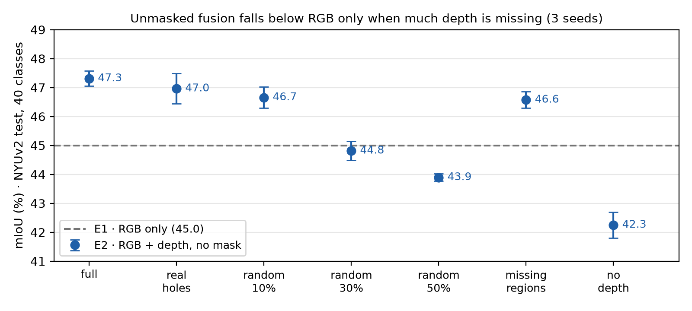

# Masked Linear Cross-Attention for Robust RGB-D Semantic Segmentation

**MLCA** fuses a frozen EfficientViT-B1 (RGB) and a frozen DeFM ResNet-18 (depth) with a linear cross-attention
that **excludes the pixels where the depth sensor gave no reading**. RGB features query; depth features answer.

$$o_i = \frac{\varphi(q_i)^\top S}{\varphi(q_i)^\top z + \varepsilon},\qquad
S = \sum_j m_j\,\varphi(k_j)\,v_j^\top,\qquad z = \sum_j m_j\,\varphi(k_j),\qquad \varphi = \mathrm{ReLU}$$

The validity mask $m_j = 0$ at depth holes removes them from both the summary and the normalizer, at linear
cost. The output projection has no bias and starts at zero, so with no valid depth MLCA contributes exactly
zero and the decoder receives only the RGB features.

Final project of *Deep Learning INF659* (MSc in Computer Science, Pontificia Universidad Católica del Perú,
2026-2) and poster at WAIMLAp 2026. **Work in progress.**

**Team:** Mónica Abarca · Marshall Fernández · Joaquin Gonzalez Villarreal · Claudia Suárez.



## Preliminary results (NYUv2, 40 classes, test, 3 seeds)

Frozen extractors; only the fusion and the EfficientViT head are trained. Predictions were written before
training ([`DECISIONES.md`](DECISIONES.md)).

| Depth condition | E1 · RGB only | E2 · RGB + depth, no mask |
|---|---|---|
| Full | 44.99 ± 0.30 | 47.31 ± 0.26 |
| Real sensor holes (`rawDepths`) | 44.99 ± 0.30 | 46.97 ± 0.52 |
| 50 % random holes | 44.99 ± 0.30 | 43.90 ± 0.12 |
| No depth (empty map) | 44.99 ± 0.30 | 42.25 ± 0.45 |

Adding depth without a mask helps while depth is available, but falls below RGB only when much of it is
missing: trained always with depth, E2 cannot tell a missing value from a measured one. E1 does not use depth,
so its value is the same in every condition. Details and all conditions:
[`notebooks/11_e1_e2_nyuv2.ipynb`](notebooks/11_e1_e2_nyuv2.ipynb).



| Experiment | Configuration | Status |
|---|---|---|
| E1 | EfficientViT, RGB only | done |
| E2 | EfficientViT + DeFM, concatenation | done |
| E3 | Linear cross-attention without mask | planned |
| E4 | **MLCA** | planned |
| E5 | E4 with and without modality dropout | planned |
| E6 | E4 with a masked softmax attention (as in UCTNet) | planned |

## Repository

```
proposal/      project proposal (Spanish), WAIMLAp extended abstract and poster, figures
src/
  mlca.py              the MLCA block
  rgbd.py              EfficientViT-B1 + DeFM ResNet-18 + fusion; DeFM preprocessing; depth conditions
  nyuv2.py             NYUv2 reader (official .mat, raw and filled depth, 40 classes)
  entrenar_rgbd.py     training and evaluation protocol
  efficientvit_seg.py  EfficientViT-Seg loader with the official weights
notebooks/
  09_mlca_bloque       the block on synthetic data: exact RGB path, exact hole exclusion, linear cost
  10_nyuv2_huecos      the real holes of NYUv2 raw depth: how many, where, which classes, which scale
  11_e1_e2_nyuv2       results of E1 and E2
DECISIONES.md  decisions and predictions written before each experiment
tools/         run a notebook end to end
```

Code and notebooks are documented in Spanish.

**Scripts produce the results; notebooks read and show them.** Training runs take 12–16 minutes each, so they
are launched from the terminal with `src/entrenar_rgbd.py`, which applies the same protocol to every experiment
(only `--exp` changes) and writes `runs/rgbd/<run>/resultado.json` with the mIoU per depth condition and per
class. `11_e1_e2_nyuv2` only reads those files. Notebooks 09 and 10 compute without training (1–3 minutes).

| File | Kind | Trains? | What it does |
|---|---|---|---|
| `src/entrenar_rgbd.py` | script | yes | Training, scene-level validation for the learning rate, final evaluation; `--reevaluar` adds new conditions to trained models |
| `notebooks/09_mlca_bloque` | notebook | no | Checks of the MLCA block on synthetic data; frozen encoders' feature shapes |
| `notebooks/10_nyuv2_huecos` | notebook | no | Real holes of NYUv2 raw depth |
| `notebooks/11_e1_e2_nyuv2` | notebook | no | Tables and figures of E1 and E2 from `resultado.json` |

## Reproduce

```bash
git clone https://github.com/joagovi/inf659-rgbd-mlca.git && cd inf659-rgbd-mlca
python -m venv .venv
.venv/Scripts/python.exe -m pip install -r requirements.txt --extra-index-url https://download.pytorch.org/whl/cu121
git clone https://github.com/mit-han-lab/efficientvit.git third_party/efficientvit
git -C third_party/efficientvit checkout de7d773
```

Data (not versioned), in `datos/nyuv2/`:

- `nyu_depth_v2_labeled.mat`: http://horatio.cs.nyu.edu/mit/silberman/nyu_depth_v2/nyu_depth_v2_labeled.mat
- `splits.mat`: http://horatio.cs.nyu.edu/mit/silberman/indoor_seg_sup/splits.mat
- `classMapping40.mat`: https://github.com/ankurhanda/nyuv2-meta-data

DeFM is loaded from `torch.hub` (`leggedrobotics/defm`) and the EfficientViT weights from Hugging Face. Then:

```bash
python src/entrenar_rgbd.py --humo                          # smoke test: a few steps
python src/entrenar_rgbd.py --barrido E2                    # learning rate on a scene-level validation split
python src/entrenar_rgbd.py --exp E2 --lr 3e-4 --semilla 0  # train on the 795 images, evaluate on the 654
python tools/run_notebook.py notebooks/11_e1_e2_nyuv2.ipynb
```

One run takes 12–16 minutes on an RTX 4060 Laptop GPU (8 GB).

## Key references

- H. Cai et al., *EfficientViT: Multi-scale linear attention for high-resolution dense prediction*, ICCV 2023.
- M. Patel et al., *DeFM: Learning foundation representations from depth for robotics*, IEEE T-RO (conditionally
  accepted), 2026. arXiv:2601.18923.
- X. Ying and M. C. Chuah, *UCTNet: Uncertainty-aware cross-modal transformer network for indoor RGB-D semantic
  segmentation*, ECCV 2022 (closest prior work: masks invalid depth inside a softmax self-attention).
- C. Liao et al., *Benchmarking multi-modal semantic segmentation under sensor failures*, CVPR Workshops 2025.
- N. Silberman et al., *Indoor segmentation and support inference from RGBD images*, ECCV 2012 (NYUv2).

## AI assistance

Code and much of the text were written with the help of Claude (Anthropic), as allowed by the course and
declared in [`DECISIONES.md`](DECISIONES.md). Predictions before each experiment and the reading of the
results are the team's.
