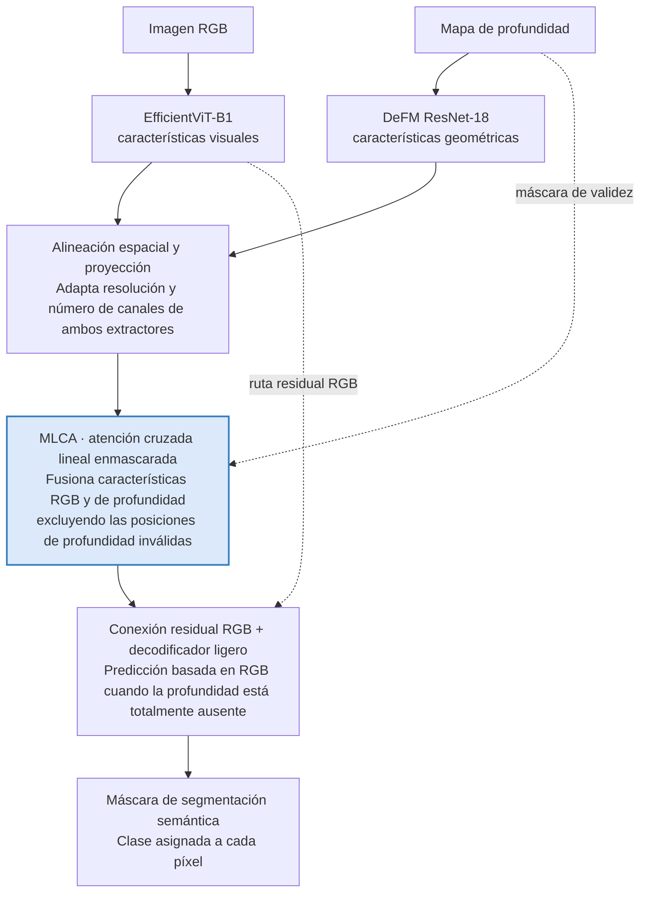

# Propuesta de proyecto: Segmentación semántica RGB-D con MLCA

**Fecha:** 14 de octubre de 2026 · **Revisión:** 22 de octubre de 2026

**Integrantes:**
- Marshall Fernandez
- Mónica Abarca
- Joaquin Gonzalez
- Claudia Suarez

## 1. Tema de investigación

**Título propuesto:** Segmentación semántica RGB-D robusta mediante atención cruzada lineal enmascarada y extractores preentrenados eficientes.

El estudio desarrollará y evaluará un mecanismo de fusión que aprovecha las características visuales RGB y las geométricas de profundidad, reduciendo la influencia de las regiones donde la profundidad es inválida o está ausente.

## 2. Pregunta e hipótesis de investigación

**Pregunta:** ¿En qué medida un mecanismo de atención cruzada lineal enmascarada mejora la precisión y robustez de la segmentación semántica RGB-D frente a estrategias convencionales de fusión, cuando la profundidad presenta ruido, regiones faltantes o ausencia total, manteniendo un costo computacional reducido?

**Hipótesis:** Un mecanismo de atención cruzada lineal que excluya explícitamente las posiciones de profundidad inválidas reducirá la pérdida de precisión de segmentación frente a mecanismos de fusión sin enmascaramiento, con un incremento acotado de parámetros y latencia.

La hipótesis es verificable experimentalmente; no se asume de antemano que MLCA superará a los métodos existentes.

## 3. Datasets propuestos

Se trabajará con dos datasets con funciones distintas, para controlar el alcance del proyecto.

| Dataset | Rol | Contenido | Partición |
|---|---|---|---|
| NYU Depth V2 | Principal | 1,449 imágenes RGB-D etiquetadas de interiores (habitaciones, oficinas y otros espacios) | 795 entrenamiento · 654 prueba |
| Cityscapes | Complementario (opcional) | 5,000 imágenes con anotaciones detalladas de distintas ciudades; incluye pares estéreo y mapas de disparidad | 2,975 entrenamiento · 500 validación · 1,525 prueba |

**Estrategia de uso:**

- **NYUv2:** entrenamiento, implementación, ablaciones y evaluación de robustez frente a profundidad incompleta.
- **Cityscapes:** comprobar si la estrategia de fusión funciona en escenas urbanas, tras adaptar etiquetas y decodificador.

El archivo oficial de NYUv2 incluye dos mapas de profundidad: el rellenado, que usan los benchmarks habituales, y el crudo del sensor, con los huecos reales. Se usará también el crudo, para evaluar con fallos reales y no solo simulados: dentro de la zona central de la imagen falta en promedio alrededor del 13 % de la profundidad.

En Cityscapes la disparidad se convertirá a profundidad métrica usando las calibraciones de cámara; los valores inválidos permiten construir la máscara de validez.

**Importante:** las clases semánticas de interiores y exteriores son diferentes. Se entrenará un decodificador específico para Cityscapes y las estrategias de fusión se compararán dentro de cada dataset; los valores de mIoU no se compararán directamente entre ambos.

## 4. Arquitectura propuesta

La arquitectura combina dos extractores preentrenados eficientes y los fusiona con MLCA, la contribución propuesta.

### Arquitectura EfficientViT + DeFM + MLCA

**MLCA fusiona RGB y profundidad sin atender a posiciones inválidas.** El siguiente diagrama reproduce en formato Mermaid el flujo representado en el documento original.

La máscara de validez se obtiene del mapa de profundidad; la ruta residual mantiene una predicción basada en RGB cuando no hay profundidad. Para que esa ruta sea exacta, la proyección de salida de MLCA no tiene sesgo y se inicializa en cero: sin ninguna posición válida, MLCA aporta exactamente cero y el decodificador recibe solo las características RGB, sin valores espurios derivados de la profundidad vacía.

| Componente | Modelo / técnica | Función |
|---|---|---|
| Extractor RGB | EfficientViT-B1 | Extraer características visuales con bajo costo computacional |
| Extractor de profundidad | DeFM ResNet-18 | Extraer características geométricas preentrenadas |
| Mecanismo de fusión | MLCA | Integrar ambas modalidades usando máscaras de validez |
| Conexión residual | RGB + salida de MLCA | Mantener una ruta RGB cuando no exista profundidad |
| Decodificador | Cabeza ligera de segmentación | Generar las etiquetas semánticas |

EfficientViT dispone de modelos y pesos públicos para segmentación semántica. DeFM proporciona modelos compactos preentrenados para profundidad y un procesamiento que conserva información de escala métrica.

Inicialmente se mantendrán congelados ambos extractores y se entrenarán las proyecciones, MLCA y el decodificador.

## 5. Contribuciones esperadas

- **C1. Metodológica:** diseño de un mecanismo ligero de atención cruzada lineal enmascarada que integre representaciones RGB y de profundidad, excluyendo explícitamente las posiciones inválidas de la modalidad geométrica.
- **C2. Experimental:** evaluación sistemática de la precisión y robustez de distintas estrategias de fusión RGB-D frente a pérdida parcial o total de profundidad y ruido.
- **C3. Computacional:** análisis del compromiso entre precisión, robustez y eficiencia mediante mIoU, parámetros, FLOPs, latencia y memoria.

Si el tiempo lo permite, contribuciones adicionales serían estudiar la transferencia del mecanismo de escenas interiores a escenas urbanas con Cityscapes y medir la latencia en un dispositivo embebido.

## 6. Originalidad

La originalidad no está en usar EfficientViT, DeFM o atención cruzada por separado, pues estos componentes ya existen. La aportación consiste en introducir y evaluar un enmascaramiento por validez dentro de una atención cruzada lineal, integrado con extractores preentrenados eficientes, para reducir la dependencia de profundidad incompleta.

| Aspecto | ¿Ya existe? | Nuestra contribución potencial |
|---|---|---|
| EfficientViT | Sí | Usarlo como extractor RGB eficiente |
| DeFM | Sí | Integrarlo como extractor de profundidad |
| Atención cruzada RGB-D | Sí (p. ej., CMX) | Comparar su versión sin máscara con MLCA |
| Enmascaramiento de modalidades | Sí | Estudiar la exclusión explícita de posiciones inválidas dentro de la atención lineal |
| Máscara de validez del sensor dentro de la atención | Sí (UCTNet, en una autoatención softmax de la rama de profundidad) | Llevarla a una atención cruzada de costo lineal y compararla con la versión softmax |
| Robustez a sensores faltantes | Sí | Cuantificar el beneficio específico del enmascaramiento y su costo |

CMX, por ejemplo, ya usa interacción cruzada entre modalidades para segmentación RGB-X. La novedad propuesta es, por tanto, combinatoria.

El antecedente más cercano es UCTNet [1], que usa la máscara binaria del sensor para impedir que los píxeles sin lectura propaguen información dentro de la autoatención de la rama de profundidad. MLCA se diferencia en tres aspectos: la máscara actúa en la atención cruzada entre RGB y profundidad, con costo lineal en lugar de cuadrático; sin profundidad, la fusión aporta exactamente cero y el decodificador recibe solo las características RGB; y se evalúa frente a pérdida parcial y total de profundidad, condiciones que UCTNet no reporta.

**Nivel de originalidad esperado:** incremental, pero defendible para un artículo de taller, sujeto a comprobar que no existe un mecanismo equivalente y a demostrar con ablaciones que MLCA aporta beneficios frente a alternativas más simples. La revisión bibliográfica realizada no encontró un mecanismo equivalente; UCTNet es el más próximo.

**Distinción técnica:** una máscara binaria identifica profundidad faltante, pero no necesariamente detecta profundidad ruidosa que conserva valores numéricos. La robustez ante ruido se evaluará por separado o se complementará con una estimación de confiabilidad.

## 7. Experimentos

Seis configuraciones aíslan, paso a paso, el aporte de la profundidad, de la atención, del enmascaramiento, del entrenamiento con fallos y del tipo de atención.

| Experimento | Configuración | Propósito |
|---|---|---|
| E1 | EfficientViT, solo RGB | Línea base |
| E2 | EfficientViT + DeFM, concatenación | Medir el beneficio de incorporar profundidad |
| E3 | EfficientViT + DeFM, atención lineal sin máscara | Aislar el efecto de la atención |
| E4 | EfficientViT + DeFM + MLCA | Aislar el beneficio del enmascaramiento |
| E5 | E4 con y sin *modality dropout* | Separar el beneficio de la arquitectura del entrenamiento con fallos |
| E6 | E4 con atención softmax enmascarada (como UCTNet) en lugar de lineal | Comparar atención lineal y softmax con la misma máscara: precisión y latencia |

**Condiciones de evaluación:**

- Profundidad completa
- Huecos reales del sensor (profundidad cruda de NYUv2)
- Huecos aleatorios del 10 %, 30 % y 50 % [2]
- Regiones faltantes contiguas, más cercanas a fallos reales de sensores [3]
- Ruido gaussiano
- Ausencia total de profundidad

**Métricas:**

| Dimensión | Métricas |
|---|---|
| Precisión | mIoU e IoU por clase |
| Robustez | Caída de mIoU respecto a profundidad completa |
| Eficiencia | Parámetros, FLOPs, latencia y VRAM |
| Rigor | Tres semillas, análisis de variabilidad y comparaciones con configuraciones equivalentes |

La evaluación principal se realizará en NYUv2. Cityscapes será una validación opcional, sujeta al tiempo disponible, y no una condición indispensable para completar la contribución.

## 8. Resultados preliminares

**Comprobaciones previas, sin entrenamiento.** Antes de entrenar se verificó, con datos sintéticos, que el bloque MLCA cumple lo que promete: sin profundidad válida devuelve exactamente las características RGB; las posiciones inválidas quedan excluidas de forma exacta, aunque contengan valores arbitrarios; y su costo crece linealmente con el tamaño de la imagen (pendiente 1.14 en escala logarítmica, frente a 2.00 de la atención softmax). También se comprobó que los dos extractores congelados entregan características de la misma resolución a 1/8, 1/16 y 1/32 de la imagen, y se midieron los huecos reales de NYUv2: dentro de la zona central falta el 12.3 % de la profundidad en el conjunto de prueba.

**E1 y E2.** Se entrenaron en NYUv2 con los extractores congelados, tres semillas y evaluación en las 654 imágenes de prueba. Las predicciones del equipo se registraron antes de entrenar.

| Condición de la profundidad | E1 · solo RGB | E2 · concatenación | E2 − E1 |
|---|---|---|---|
| Completa | 44.99 ± 0.30 | 47.31 ± 0.26 | +2.32 |
| Huecos reales del sensor | 44.99 ± 0.30 | 46.97 ± 0.52 | +1.98 |
| Huecos aleatorios del 10 % | 44.99 ± 0.30 | 46.66 ± 0.36 | +1.67 |
| Huecos aleatorios del 30 % | 44.99 ± 0.30 | 44.82 ± 0.32 | −0.17 |
| Huecos aleatorios del 50 % | 44.99 ± 0.30 | 43.90 ± 0.12 | −1.09 |
| Regiones faltantes contiguas | 44.99 ± 0.30 | 46.58 ± 0.28 | +1.59 |
| Ausencia total | 44.99 ± 0.30 | 42.25 ± 0.45 | −2.74 |

*mIoU (%) de 40 clases. E1 no usa profundidad, por lo que su valor no cambia entre condiciones. Las regiones contiguas son rectángulos sin profundidad (corrupción* hole *de GeomPrompt [3], severidad 0.5). En la ausencia total se entrega a E2 un mapa de profundidad vacío: E2, entrenada siempre con profundidad, no puede distinguir la ausencia de un valor medido, por lo que no equivale a E1, que no tiene rama de profundidad. El ruido gaussiano está pendiente.*

Incorporar la profundidad sin máscara mejora la segmentación cuando está completa (+2.3 puntos), pero la ventaja se reduce a medida que faltan píxeles: desaparece hacia el 30 % de huecos aleatorios y, con el 50 % o sin profundidad, el resultado queda por debajo de la red solo RGB (−1.1 y −2.7 puntos). Es el problema que MLCA busca resolver. E3 a E6 están pendientes.

## Referencias

[1] X. Ying y M. C. Chuah, «UCTNet: Uncertainty-Aware Cross-Modal Transformer Network for Indoor RGB-D Semantic Segmentation», ECCV 2022.
[2] C. Liao et al., «Benchmarking Multi-modal Semantic Segmentation under Sensor Failures: Missing and Noisy Modality Robustness», CVPR 2025 Workshops. arXiv:2503.18445.
[3] «GeomPrompt: Geometric Prompt Learning for RGB-D Semantic Segmentation Under Missing and Degraded Depth», CVPR 2026 Workshops. arXiv:2604.11585.
